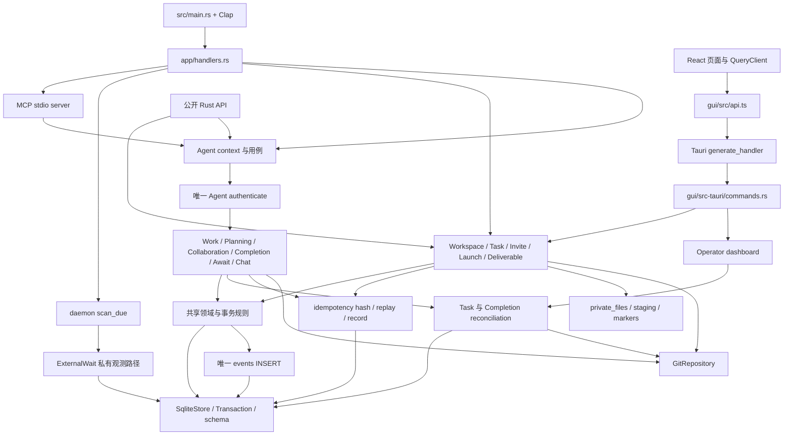

# 调用与配置拓扑

审计范围：2026-09-21 至 2026-09-22 的第一方源码、生产入口、序列化边界、构建配置和资源引用。逐项变更与验证结果见 [冗余清理记录](REDUNDANCY_CLEANUP.md)。

本表按入口、用例、共享规则、持久化/外部系统、反向消费者逐层展开。搜索结果只用于发现候选；删除判断还核对了接收者类型、函数值、宏注册、DTO 字段、SQL 约束、状态转换和实际调用。仅出现于测试的业务旧实现与专用测试工具分别判断，不能用全仓同名词频替代可达性分析。

## 总体执行图

这里的鉴权箭头指 Agent 用例。工作区所有者的本地管理入口、只读 Operator 查询和系统扫描使用各自明确的权限边界；没有让后台扫描伪造 Session 凭据。所有入口共用业务服务，不存在单独的 GUI 业务副本。

## CLI 与进程入口

`main -> logging/init -> Cli::parse -> cli::run -> handlers::dispatch` 是唯一 CLI 分派链。`Clap` 的子命令、参数冲突、必填项、`ValueEnum` 和环境变量均属于实际调用边。

| 顶层命令族 | 后续入口与边界 |
| --- | --- |
| `init`、`workspace` | WorkspaceService、workspace initialize/link/discover；仓库实例身份、配置路径、数据库位置与锁 |
| `gui` | 明确的 executable override / 同目录 / PATH 查找，启动独立桌面进程；foreground 决定是否等待退出 |
| `launch`、`prompt`、`config` | settings -> LaunchService / InvitationService；preflight、发布、resume、列出/读取 prompt 与 profile |
| `status`、`watch`、`task` | 同一 TaskService、任务引用解析和 reconciliation；快捷命令不另写业务逻辑 |
| `agent` | Join、whoami、sync/next/preview、operation catalog、proposal/consolidation、chat、await、intent、conclude/resume/leave |
| `capability`、`participant` | CollaborationService 的能力、责任与退休操作；参与者读取投影 |
| `requirement`、`gap`、`item`、`plan` | PlanningService；直接应用或 PlanOperation -> CollaborationService 审批，最终调用相同的变更函数 |
| `work` | WorkflowService 的 start/adopt/submit/review/integration prepare/confirm，以及 SpeculativeService |
| `claim`、`attempt`、`artifact`、`evidence`、`review`、`changeset` | WorkService 的低层公开入口；与 Workflow 共用事务内实现及政策 |
| `blocker`、`approval`、`contract`、`decision`、`coord`、`invalidation` | CollaborationService；各实体的状态、版本、证据和审计事件 |
| `deliverable` | DeliverableService；映射与核验复用 evaluate_deliverable，TaskReconciler 也使用该规则 |
| `logs`、`diagnostics`、`doctor`、`migrate` | 日志、协作诊断、环境诊断和显式迁移；不是业务成功的默认替代路径 |
| `mcp` | stdio JSON-RPC 分派到下面列出的 9 个工具 |
| `daemon` | 已打开的工作区数据库 -> ExternalWaitService::scan_due -> 私有 poll_wait；系统身份来自查询结果 |

CLI 输入文件、stdin、命令行 override 只在 handlers 边界解析；持久化值由 storage 解码。请求文本不拼接成 shell 命令，Git 和 GUI 子进程使用 argv。

## app 模块覆盖矩阵

| 模块 | 活跃消费者 / 入口 | 向下展开及判定 |
| --- | --- | --- |
| `mod.rs` | lib 导出 | 模块注册；旧 dispatch 和 absolute_path 转发已移除 |
| `handlers.rs` | CLI 唯一 dispatch | 上表全部命令族、文件输入、输出、watch/await 循环、GUI 子进程；不作为第二套领域实现 |
| `runtime.rs` | Agent 命令、workspace 管理 | context 文件 -> 工作区发现 -> 数据库绑定；解析与调用凭据验证分别负责格式和真实性 |
| `workspace_service.rs` | CLI init、GUI initialize | workspace 配置与仓库实例 -> SqliteStore migration -> 工作区记录与审计 |
| `settings.rs` | CLI config/launch、GUI launch | 项目 settings.toml -> schema/profile 校验 -> 唯一 profile 选择；GUI 不硬编码项目默认名 |
| `launch.rs` | CLI/GUI launch、CLI resume | Git baseline、Task publish、邀请批次、持久 marker、分阶段恢复与文件锁 |
| `invite.rs` | CLI invite/prompt、GUI prompt、Launch | Task 状态、批次准备/恢复、令牌、manifest、可发送性、文件产物、幂等；ensure_sendable 为唯一判定 |
| `join.rs` | CLI agent join | 邀请保留/消费、Git worktree、Session/Participant、context 文件、恢复 marker；UUID request key 是独立文件身份合同 |
| `task.rs` | CLI/GUI 生命周期、Agent/Operator health | publish/criteria/phase、任务引用、健康计数、epoch 迁移；reopen 和 criteria 变更共用迁移参与者实现 |
| `agent.rs` | CLI/MCP、其它 Agent 服务 | authenticate、token、worker 写资格、waiting 激活、sync/next、proposal/consolidation、各读取投影；集成建议一次读取同一变更集及资源，解析失败向上传播；系统扫描不调用空凭据通道 |
| `planning.rs` | CLI requirement/gap/item/plan、Workflow | 规格规范化、提案、关系、split/supersede/reopen；PlanOperation、覆盖、依赖、版本、幂等和事务 |
| `work.rs` | CLI 低层工作操作、Workflow、Planning 组合操作 | claim/reclaim/renew/close、scope、checkpoint、artifact/evidence、submit、review、integration；资源和评审政策仅一份 |
| `workflow.rs` | CLI work facade | 组合 Work/Planning 事务方法、Git 集成 preflight/confirm、准备记录；所有 confirm 分支先鉴权 |
| `collaboration_service.rs` | CLI collaboration、规划审批 | intent、coordination、contract、decision、invalidation、retirement、capability、blocker、approval；应用/拒绝 typed PlanOperation |
| `completion_service.rs` | CLI/MCP conclude，生命周期与业务写后 | Participant/Conclusion/Cohort -> CompletionReducer -> 完成记录、警告与事件；数据库载入共用解码 |
| `await_service.rs` | CLI/MCP durable await、Work/Task/退休回调 | register/show/list/poll，目标状态/责任链/环检测、终态与 Participant 唤醒；原等待记录是结果来源，outbox 仅投递进度 |
| `external_wait.rs` | CLI/MCP、daemon、Task/退休回调 | 文件 detector、deadline、复查、终态、投递；公开 poll 鉴权，内部观测接收真实 DB 身份；入队 SQL 共用 |
| `runtime_reconciler.rs` | Agent 读取与写后 | 顺序协调 TaskReconciler 和 CompletionService；不是另一套 reducer |
| `task_reconciler.rs` | CLI status/diagnostics、Operator、Agent | Git 可观察性/祖先关系、集成漂移、需求覆盖和交付物核验；共用 evaluate_deliverable |
| `deliverable.rs` | CLI、Agent/Operator 投影、TaskReconciler | add/map/verify/list；代码交付物的已集成提交与归属 Evidence，非代码交付物的明确 Evidence |
| `speculative.rs` | CLI work speculate、Agent proposal | 隔离探索 start/checkpoint/adoption/abandon；创建摘要复用公共幂等，checkpoint 不能越权或复活终态 |
| `chat.rs` | CLI/MCP、GUI、Agent inbox | Agent/operator sender 边界、唯一发送事务、history/recent/inbox/receipt/await；sender 不是统一 UUID 类型 |
| `operator.rs` | Tauri commands | task list/dashboard -> 共享 Task/Completion/Deliverable/Chat；专用投影不是独立写政策，JSON 字段与服务共用类型 |
| `collaboration_projection.rs` | Agent sync、diagnostics | 参与者活性与责任投影；limit=None 是明确全量诊断，不是转换失败后的极值替代 |
| `diagnostics.rs` | CLI/Tauri collaboration diagnostics | 集成完整性和责任链 -> 可解释 findings；错误不转成健康计数 |
| `maintenance.rs` | CLI/Tauri doctor、CLI migrate | Git/目录/DB/schema 检查和迁移；诊断 fail/warning 保留真实条件 |
| `events.rs` | 所有事件写入服务、完成记录和元数据 | append_session -> append -> 唯一 INSERT；latest_cursor 统一最新事件游标，空流 0 是查询中性值；事件分页识别空流的 nullable MAX 是不同合同 |
| `idempotency.rs` | 具有请求重放合同的用例 | hash/replay/record、actor key、RequestIdPolicy、UUID 文件请求身份；不把语义 dedupe 当作请求重放 |
| `validation.rs` | Planning、Collaboration 输入规范化 | 必填文本与字符串集合的共同校验；保序段落和不同大小写合同保留其原生操作，避免改变幂等摘要 |
| `operation_contract.rs` | CLI agent operations、Agent next 引用 | 静态操作目录和示例 argv；用 Clap 实际解析验证注册合同 |
| `mcp.rs` | CLI mcp serve | 协议封装、工具 schema/dispatch、deferred response、flush 后确认投递；服务错误明确 isError |

## 共享模块与隐式调用

| 范围 | 显式与隐式边 |
| --- | --- |
| `lib.rs`、`main.rs`、`cli.rs` | crate 导出、二进制入口、Clap derive/Subcommand/Args/ValueEnum、环境参数、输出和日志 span |
| `clock.rs` | 唯一自有运行时 trait：Clock；SystemClock、FakeClock、`&T` 实现。FakeClock/advance 是注入测试时钟，不是另一套业务状态机 |
| `error.rs`、`output.rs`、`logging.rs` | thiserror/From -> ErrorCode/details/exit code -> CLI/MCP/Tauri；human formatter 返回 Result；日志 guard 的 Drop 刷新队列 |
| `private_files.rs`、`workspace.rs` | 相对路径、配置发现、实例 ID/锁、原子 CreateNew/Replace、fsync、JSON/TOML；只有确实 NotFound/AlreadyExists 的相应分支处理缺失/竞争 |
| `git.rs` | 固定 argv 的 GitRepository 操作、Git 发现与诊断；工作树路径、提交/祖先、差异/脏路径、分支与 worktree 生命周期 |
| `domain/ids.rs`、`model.rs`、`mod.rs` | id_type/string_enum 宏、FromStr/Display、Serde、Clap；ParticipantState 的 heartbeat 状态集合同时供 Rust 判定、CompletionCohort 校验与 SQL 参数消费；字符串是公开协议，不按 Rust 字段未直接读取删除 |
| `domain/participant.rs` | Record 校验 -> resume/conclude/leave；旧 new/retire/supersede/wait 业务副本已删除。Waiting 可从真实记录载入，生产等待在 durable 服务 |
| `domain/completion.rs` | 版本/epoch CAS、Conclusion、SignalSnapshot、Cohort、Reducer 与 digest；TryFrom、Serialize 和 reducer 分派均是消费边 |
| `invitation/{mod,token,secret,duration,prompt,files}.rs` | 安全随机、哈希比较、秘密文件协议、时间格式、两种 shell、PromptRenderer、BatchStaging；tempfile 的 persist/keep/Drop 是恢复生命周期的一部分 |
| `storage/{mod,sqlite,migration_lock,migrations,values}.rs` | SQLite PRAGMA、shared/exclusive 文件锁、备份、Transaction commit/drop、脚本列表、字段解码；SQL 回调错误装箱后 details downcast 保留诊断 |
| `storage/schema_v1.sql` 至 `schema_v22.sql` | include_str 加载；FK、CHECK、UNIQUE、部分索引、不可变审计 trigger。旧脚本仍是升级入口，当前版本由脚本列表长度生成 |

第一方模块中没有独立的反射容器、动态代理、AOP、XML 业务装配或第三方插件发现器。实际动态边为 Clap/Serde/Tauri 宏、函数值/闭包、Clock 注入、SQL 和文件格式、Tauri State、React Query 回调、DOM class/事件与进程 argv。Android XML 属于图标资源，不是业务注入配置。

## Tauri IPC 全部注册

`gui/src-tauri/main.rs -> lib.rs::run -> Builder::manage(AppState) + generate_handler!` 注册以下 14 个命令；`api.ts` 对应 invoke 名字，命令参数的 camelCase/snake_case、Option 和 JSON DTO 同时核对。

| IPC | 唯一服务路径 |
| --- | --- |
| workspace_restore | GuiPreferences -> workspace discover；仅缺失的历史工作区清除偏好 |
| workspace_open | discover -> remember -> WorkspaceView |
| workspace_initialize | WorkspaceService initialize -> discover -> remember |
| task_list | OperatorService list_tasks |
| task_snapshot | OperatorService dashboard -> Task/Completion reconciliation + 读取投影 |
| chat_send | ChatService send_operator -> 共享发送事务 |
| launch_preflight | settings/profile -> LaunchService preflight |
| launch_execute | 同一 launch_request -> LaunchService launch |
| prompt_list | InvitationService list，元数据模式 |
| prompt_show | InvitationService show，正文及可发送性检查 |
| task_transition | typed TaskAction -> TaskService pause/resume |
| doctor_run | maintenance::doctor |
| collaboration_diagnostics | reconciliation -> diagnostics::analyze |
| logs_tail | logging::tail |

`GuiError` 只转换错误协议，不补造成功 DTO。`AppState` 的 Mutex 管理 GUI 偏好；业务数据仍在工作区 SQLite。Dialog 和 Clipboard 插件独立注册，能力文件仅授权主窗口相应操作。

## MCP 全部工具注册

| 工具名 | 服务 |
| --- | --- |
| sessionbridge_agent_next | AgentService next / next_preview |
| sessionbridge_agent_conclude | state token 验证 -> CompletionService conclude |
| sessionbridge_await_work_items | AwaitService register/poll -> AwaitResult -> flush -> 投递确认 |
| sessionbridge_await_external | ExternalWaitService register/poll -> ExternalWaitView -> flush -> 投递确认 |
| sessionbridge_chat_send | ChatService send_agent |
| sessionbridge_chat_history | ChatService history |
| sessionbridge_chat_inbox | ChatService inbox |
| sessionbridge_chat_ack | ChatService ack_agent |
| sessionbridge_chat_await | ChatService await_agent |

控制方法 initialize、notifications/initialized、ping、tools/list、tools/call 也在同一分派中。未知方法/工具明确失败；工具业务错误返回 isError，不回落到伪造数据。请求重放从原等待记录加载结果，投递队列只保留状态、次数和时间。

## 前端状态与资源路径

| 页面 / 组件 | 输入、状态及动态边 |
| --- | --- |
| App / WorkspaceChooser | restore/open/initialize；原生目录选择器取消是 None，选择器错误可见；Task 列表失败不显示为零任务 |
| Sidebar / 当前 Task | tasks query、selected ID、dashboard query；当前 Dashboard 只在对应 Task 仍存在时渲染 |
| Overview | 共享 health/pipeline/deliverables/events；仅显示机械条件，不自行宣布语义完成 |
| WorkView | 列表/搜索/ReactFlow；动态 state class，过滤后的节点集合限制边的端点 |
| AgentsView | participants、invitation seats、durable/external waits，独立时间字段 |
| ChatView | Task key 隔离草稿/回复/错误；useMutation 为发送状态唯一来源 |
| ActivityView | 事件列表和过滤，Event cursor 来自后端 |
| DiagnosticsView | 三个 query 各自有错误/重试，日志读取错误不显示成空日志 |
| Inspector | 直接使用 dashboard.details.task，删除来自 task list 的第二份 Task 参数；transition 错误可见 |
| LaunchDialog | useMutation 保存 preflight/错误；关闭/返回清理原查询状态，迟到结果不恢复旧预检；默认 profile 交由项目配置 |
| PromptDialog | 只保存 selectedId，正文 query 按 ID 分开；迟到的 A 响应不能覆盖 B；复制使用当前正文 |
| ModalContent / ErrorPanel / ErrorCard | 现有 Radix primitive、统一焦点恢复、错误语义和展示；没有第二套 modal/错误数据协议 |
| QueryClient | 所有操作都是本地 IPC，networkMode=always 去掉浏览器联网状态对本地操作的多余门控 |

主题 data 属性、state/risk class、ReactFlow class 和条件渲染属于样式消费者，不能因为 CSS 选择器没有完整字符串字面量就删除。样式入口为 `main.tsx -> @xyflow/react/dist/style.css + styles.css`；Tailwind preflight、Vite 插件和 Radix 原语都有真实渲染作用。

## 配置与静态资产

| 文件 / 配置 | 消费者与裁决 |
| --- | --- |
| Cargo.toml / Cargo.lock / rust-toolchain.toml | workspace、发布 include、二进制/库、依赖、Rust 1.95、release profile；machete 与编译共同检查依赖，不删除 Tauri 的传递依赖 |
| .github/workflows/ci.yml | 当前 Ubuntu Rust/前端/桌面检查；先预编译，测试阶段 60 秒超时 |
| 旧根目录 nextest.toml | 当前 CI/脚本不消费，且不在 nextest 的默认配置目录；删除并更新 PROJECT_PLAN 的实际 CI 命令 |
| gui/package.json / package-lock.json | dev/build/test/tauri 入口；React、Query、Tauri、Radix、ReactFlow、Lucide 和 Tailwind 均有消费者 |
| gui/tsconfig*.json | 项目引用、app/node 边界、noEmit、unused 检查、缓存位置；由 tsc -b 加载 |
| gui/vite.config.ts | React/Tailwind 插件、固定本地开发端口；无消费者的 TAURI_ENV_ 客户端暴露配置已删除，Tauri 构建 hook 环境不受影响 |
| gui/index.html / src/main.tsx | 文档、CSS 与 React/QueryClient 挂载；本地桌面 CSR，不是公开搜索站点 |
| gui/src-tauri/build.rs / tauri.conf.json | tauri-build、generate_context、前端构建、devUrl/frontendDist、主窗口、Linux bundle targets 和显式 bundle.icon |
| capabilities/default.json | generate_context 的主窗口能力；dialog open 与 clipboard write 对应实际插件调用 |
| gui/src-tauri/icons | 窗口图标由 Tauri codegen 消费；bundle.icon 显式绑定现有 512×512 icon.png，供 AppImage 和 deb launcher 使用。平台图标族和 SVG 原稿是构建/设计资源；未将未启用的 mobile 生成资源说成活跃业务入口 |
| linuxdeploy / AppImage runtime / 宿主图形驱动 | Tauri 外部工具缓存 -> GTK 插件 -> AppDir -> ELF 动态加载 -> 宿主 Mesa/Wayland。2024 旧工具把 Wayland client 私有副本置于宿主库之前，实际造成缺符号；官方 2026-09-01 工具按当前 excludelist 自动排除此副本，宿主显示协议与图形栈重新使用同一套库，真实包与 EGL 对照已验证 |
| .editorconfig / .gitattributes / .gitignore | 编辑/文本归一化、构建与私有状态排除；不是运行时无效变量 |
| .github 模板、release/dependabot 配置、LICENSE* 与维护文档 | GitHub/发布/法律和维护消费者；与业务执行模块分别标识 |
| docs/ui-mockups | 用户独立的设计预览资产，未改动；索引链接 12 个 HTML，117 条本地页面/资源引用无缺失 |

静态预览的实际链为 HTML -> tokens/atoms/layout/pages/polish CSS -> mock-data -> icons -> shell -> 页面脚本。`SB_ICONS`、`SB` 全局、动态 innerHTML/class 和 DOM 事件是隐式消费者。该目录明确使用模拟数据供设计预览，不能混入生产 Tauri 数据链，也不以产品服务重构覆盖用户的独立修改。

## 保留依据与验证界限

| 项目 | 保留理由 / 实际边界 |
| --- | --- |
| 历史 migrations、准备/恢复 marker | 活跃数据升级和跨 DB/文件的故障恢复链；删除会损害数据完整性 |
| 无结果计数 0、可空字段、默认 profile/lease/输出格式 | 明确的缺省业务输入或查询中性值；与解析失败后编造数据不同 |
| 多协议 DTO | CLI/MCP/Tauri 和 Agent/Operator 的作用域不同；共享规则和解码，不合并不同权限/展示合同 |
| 预览/完整同步/不限诊断数量 | 有真实调用者及验证；不能用固定限制或成功占位替代 |
| Unix 条件分支 | 当前 Linux 已编译运行；0600/0700、文件锁、目录 fsync、Git 与 native WebKit 路径均有实际检查 |
| 非 Unix 条件分支 | 已检查源码与条件注册；此环境只安装 x86_64-unknown-linux-gnu。非 Unix 私有目录 ACL 是明确 warning，目录 fsync 没有等价保证；没有宣称全平台实测 |
| PowerShell / mobile / macOS / Windows | shell 字符串合同有测试；mobile entry 与平台图标注册有源码覆盖。没有相应运行宿主，不能把 Linux 或 Chromium 检查等同于这些平台运行验证 |
| 前端质量技能 | 用于本地 IPC 状态、键盘与渲染复核；不扩展为新营销站、移动端重设计、SEO 或新性能工程。正式桌面最小宽度是 1024 |

当前验证证据包括 workspace 单测/集成测试、迁移、Git、MCP 进程崩溃恢复、类型检查、Clippy、依赖检查、生产前端、Chromium 状态场景和本地发布版真实 IPC。截图注入场景用于验证前端错误与竞态，真实 IPC 使用隔离的临时工作区与私有配置，二者在台账中分别记录。最终包和焦点修复的复验结果以台账末尾为准，不用某一项检查替代另一项。

## 接续审计的覆盖核对

- 生产 Rust 范围为 `src/**/*.rs` 和 `gui/src-tauri/src/**/*.rs` 共 62 个文件；app 有 30 个注册模块，连同 mod.rs 为 31 个文件，注册与实际文件集合相等。
- `generate_handler!`、`api.ts` 的 14 个 invoke 名称逐项一致；MCP 的 9 个工具名和迁移的 22 个 include_str 文件与实际清单相等。机器核对结果保存在 `target/cleanup-verification/registration-coverage.json`。
- 词法扫描仅作为候选发现，不能代替有接收者类型的 BFS。两个单名候选分别是注入测试时钟的 `FakeClock::advance` 和由 Serde 调用的 `InviteToken::serialize`，都有明确消费者。原始范围与候选见 `target/cleanup-verification/symbol-candidates.json`。
- `main` 的可选日志上下文读取不决定业务成功，正式 context 的解析/鉴权仍在运行时边界；stderr 输出失败后的错误文本尝试也不返回业务成功。回滚/Drop 的 best-effort 清理保留原失败，并依赖持久 marker 恢复，未作为可删除的成功回退。
- CLI 的 Evidence 文件可用数组或带 evidence 字段的对象，两种当前输入均在一个边界解析后进入同一服务；没有旧版本 schema 分支。保序文本列表、排序去重的集合、UUID 请求身份和原样保存的幂等键具有不同合同，不以统一名义改变其数据。
- GUI 是本地 CSR 工具，复核范围是 IPC、错误、异步状态、键盘及渲染。公网站 SEO、服务端渲染、广告/同意管理、公开流量 Lighthouse 门限不适用；本次没有增加前端依赖或改动资源加载。390 宽度只作布局压力检查，正式桌面最小宽度为 1024。既有 CSS 在 1024 隐藏 Inspector，因此六页布局通过不等同于该宽度所有操作按钮已验收。
